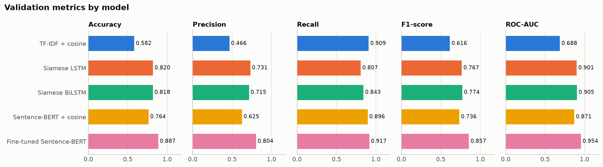
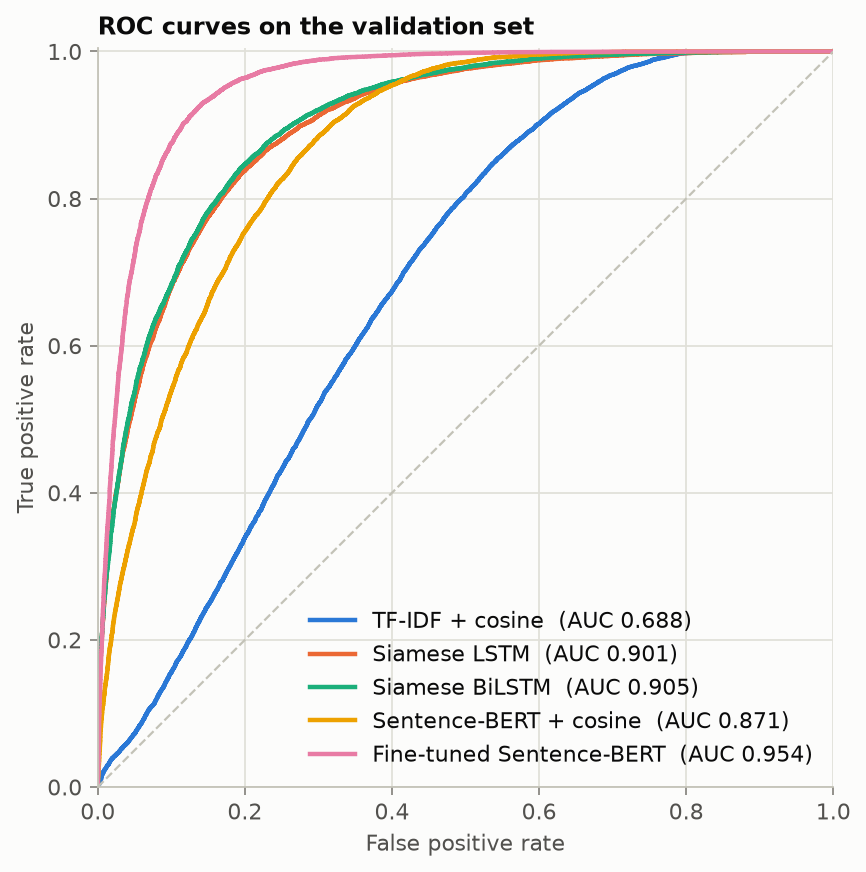
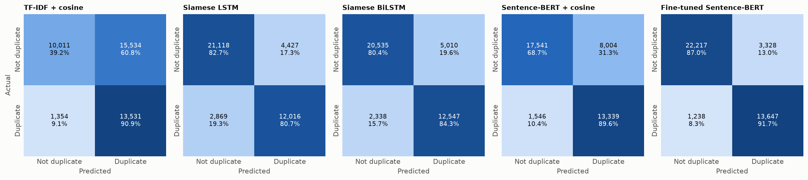

# Duplicate Question Detection on Quora Question Pairs

Given two questions, decide whether they ask the same thing. This repository
implements five approaches, from a bag-of-words baseline to a fine-tuned
transformer, and compares them under a single evaluation protocol on the
[GLUE QQP](https://huggingface.co/datasets/nyu-mll/glue) dataset.

| Question 1 | Question 2 | Label |
|---|---|---|
| How can I learn Python? | What is the best way to study Python? | Duplicate |
| How can I learn Python? | What is Java programming? | Not duplicate |

## Results

Official GLUE QQP validation set, 40,430 pairs, 36.8% duplicates.

| Model | Accuracy | Precision | Recall | F1-score | ROC-AUC | Train time (min) | Inference (pairs/s) |
|---|---:|---:|---:|---:|---:|---:|---:|
| TF-IDF + cosine | 0.5823 | 0.4655 | 0.9090 | 0.6157 | 0.6879 | 0.2 | 29,161 |
| Siamese LSTM | 0.8195 | 0.7308 | 0.8073 | 0.7671 | 0.9011 | 5.6 | 55,921 |
| Siamese BiLSTM | 0.8183 | 0.7146 | 0.8429 | 0.7735 | 0.9048 | 5.7 | 45,881 |
| Sentence-BERT + cosine | 0.7638 | 0.6250 | 0.8961 | 0.7364 | 0.8707 | - | 2,282 |
| **Fine-tuned Sentence-BERT** | **0.8871** | **0.8039** | **0.9168** | **0.8567** | **0.9541** | 26.5 | 2,139 |

Training time and inference throughput were measured on an NVIDIA RTX 3050
Laptop GPU (4 GB); TF-IDF runs on the CPU. Every number above is produced by
`qqp train all` and stored under [`results/`](results).



| ROC curves | Confusion matrices |
|---|---|
|  |  |

Training curves:
[Siamese LSTM](results/figures/siamese_lstm_training.png) ·
[Siamese BiLSTM](results/figures/siamese_bilstm_training.png) ·
[Fine-tuned Sentence-BERT](results/figures/sbert_finetuned_training.png)

### Findings

- **Fine-tuned Sentence-BERT is the best model on every metric** (F1 0.857,
  ROC-AUC 0.954) and is the one selected for the demo.
- **Task-specific training matters more than pretraining.** The pretrained
  encoder used as-is (F1 0.736) is beaten by both LSTMs trained from scratch
  on QQP (F1 0.767 and 0.774). Fine-tuning the same encoder adds 12 points of
  F1.
- **Bidirectionality buys little here.** The BiLSTM edges the LSTM on F1 and
  ROC-AUC by under one point and is level on accuracy.
- **Word overlap is a weak signal.** TF-IDF only reaches 0.91 recall by
  flagging most pairs as duplicates; its accuracy (0.582) is below the 0.632
  obtained by always answering "not duplicate". Many non-duplicate pairs in
  QQP share most of their words.
- **Accuracy costs compute.** The LSTMs train in under six minutes and score
  about 50,000 pairs per second; the fine-tuned transformer takes 26.5 minutes
  to train and scores about 2,100 pairs per second.

## Evaluation protocol

All five models are trained and scored on identical data.

| Split | Pairs | Source | Used for |
|---|---:|---|---|
| Train | 345,653 | 95% of GLUE train | Fitting model parameters |
| Tune | 18,193 | 5% of GLUE train, stratified | Early stopping, threshold selection |
| Validation | 40,430 | GLUE validation | Reported metrics only |

- Each model outputs one score per pair. Its decision threshold is the value
  that maximises F1 on the **tune** split, and is then applied unchanged to
  validation. Validation labels never influence training, model selection or
  thresholds.
- The TF-IDF vocabulary and the LSTM vocabulary are built from the train split
  only.
- F1 and ROC-AUC are the headline metrics because the classes are imbalanced
  (63% / 37%); accuracy alone rewards predicting "not duplicate".
- The split is seeded (`seed: 42`), so every run sees the same partition.

## Models

| Model | Summary |
|---|---|
| **TF-IDF + cosine** | Unigram and bigram TF-IDF vectors; score is their cosine similarity. No learned notion of meaning, only word overlap. |
| **Siamese LSTM** | Shared embedding and LSTM encode each question; max-pooled states `u`, `v` are combined as `[\|u − v\|, u ⊙ v]` and classified by an MLP. Embeddings are trained from scratch. |
| **Siamese BiLSTM** | Same network with a bidirectional encoder. |
| **Sentence-BERT + cosine** | Pretrained `all-MiniLM-L6-v2` sentence embeddings, cosine similarity, no training. |
| **Fine-tuned Sentence-BERT** | The same encoder fine-tuned on the train split with an online contrastive loss, which updates only on the hard pairs in each batch. |

The Siamese pair representation is symmetric by construction, so swapping the
two questions cannot change a prediction.

## Getting started

Requires Python 3.10+ and, for the neural models, a CUDA GPU (4 GB is enough).

```bash
python -m venv .venv
.venv\Scripts\activate          # Linux/macOS: source .venv/bin/activate
pip install torch --index-url https://download.pytorch.org/whl/cu124
pip install -e ".[demo,dev]"
```

### Reproduce the experiment

```bash
qqp train all
```

This downloads the dataset, trains each model, and writes metrics, figures and
the comparison table to `results/` and trained models to `artifacts/`. The
full run takes about 40 minutes on the GPU above. Useful variations:

```bash
qqp train tfidf siamese_bilstm       # selected models only
qqp train all --subsample 20000      # quick end-to-end check
qqp report                           # rebuild table and figures from saved results
```

Hyperparameters live in [`configs/default.yaml`](configs/default.yaml); pass
`--config path.yaml` to use another file.

### Classify a pair

```bash
qqp predict "How can I learn Python?" "What is the best way to study Python?"
```

`--model` selects a specific model (`tfidf`, `siamese_lstm`, `siamese_bilstm`,
`sbert`, `sbert_finetuned`); the default is the best model by validation F1.

From Python:

```python
from qqp.inference import load_detector

detector = load_detector("best")
prediction = detector.predict("How do I lose weight?", "What is the best way to lose weight?")
print(prediction.label, prediction.score)
```

### Demo app

```bash
python app/demo.py
```

Opens a local web page where two questions are scored by every trained model
side by side.

### Tests

```bash
pytest
```

## Repository layout

```
configs/default.yaml     hyperparameters for every model
src/qqp/
  data.py                dataset loading, text normalisation, splits
  metrics.py             threshold selection and evaluation metrics
  models/                tfidf.py, siamese.py, sbert.py
  pipeline.py            trains, evaluates and saves one model
  report.py              comparison table and figures
  inference.py           loads trained models for prediction
  cli.py                 the `qqp` command
app/demo.py              Gradio demo
tests/                   unit tests
results/                 metrics, comparison table and figures (committed)
artifacts/               trained models (generated, not committed)
```

## Limitations

- `all-MiniLM-L6-v2` was pretrained on a large corpus of sentence pairs that
  includes Quora duplicate questions, so the "Sentence-BERT + cosine" row is
  not a zero-exposure baseline.
- Results are from a single seed, so run-to-run variance has not been
  measured. The small gap between the two LSTMs should not be over-read.
- QQP labels are known to be noisy, which caps the accuracy any model can
  reach on this benchmark.
- The LSTMs learn embeddings from scratch; pretrained word vectors would
  likely narrow the gap to the transformer.
